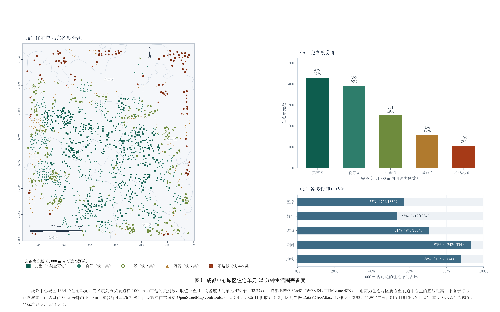
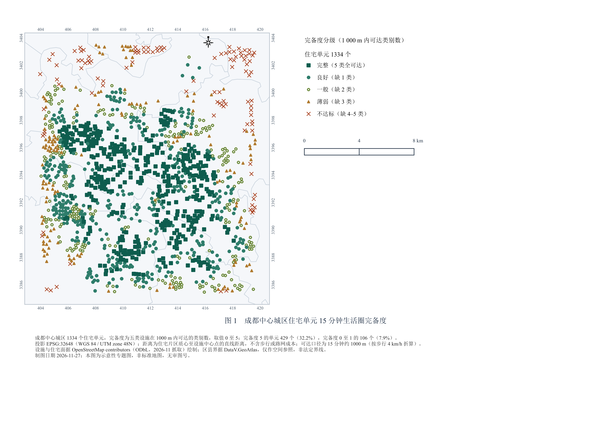

# 15 分钟生活圈完备度评估（成都住宅单元 · 5 类设施）

用 GeoPandas 对成都中心城区住宅片区的五类日常设施（医疗、教育、购物、公园、地铁）做 1 000 m 可达性评估，输出完备度评分（0—5）、明细表、GeoJSON 与专题图。

1 334 个住宅单元、846 个设施、UTM 48N 下的直线距离。全部五类可达的单元占 32%，医疗与教育为主要约束（可达率 57% 与 53%）。流程为 `fetch → clean → nearest-neighbour → score → map`，可逐步复算。

## 一、内容

输入住宅片区点位与设施点位，输出每个单元的完备度（1 000 m 内可达的设施类别数）、评分表、可载入 QGIS 的 GeoJSON 与一张专题图。分级结果可用于比较不同单元的五类设施配置差异，并定位缺少的类别。

| Python 版专题图 | QGIS 版打印布局（A4 横向） |
|---|---|
|  |  |

两版使用同一份 `data/life_circle_scores.geojson`，指标一致，差别仅在版式：Python 版为单幅横排，QGIS 版按 A4 打印排版。

## 二、方法与口径

单一设施的距离只描述该设施的可达性。本评估把五类设施的可达结果相加，得到 0—5 的完备度，使单元之间可按同一口径排序，并可拆解到具体类别。

| 项 | 口径 |
|---|---|
| 分析单元 | 住宅片区：OSM `landuse=residential` 面，面积 ≥ 2 000 m²，取质心；相邻质心 < 150 m 合并为同一片区 |
| 设施 5 类 | 医疗 `amenity=hospital/clinic`、教育 `amenity=school/kindergarten`、购物 `shop=supermarket/convenience`、公园 `leisure=park`、地铁 `railway=station & station=subway` |
| 距离口径 | 直线距离，在 EPSG:32648（WGS 84 / UTM zone 48N）下计算 |
| 可达阈值 | 15 分钟对应 1 000 m，5 分钟对应 400 m（按步行 4 km/h 折算） |
| 完备度 | 1 000 m 内可达的设施类别数，取值 0—5 |
| 分级 | 5 完整、4 良好、3 一般、2 薄弱、0—1 不达标 |
| 数据来源 | OpenStreetMap contributors（ODbL），2026-11 抓取 |
| 底图 | 成都市区县行政界线（DataV.GeoAtlas），非法定界线，仅作空间参照 |

规模：住宅单元 1 334 个（面积中位数 26 493 m²）；设施 846 个（公园 354、购物 191、地铁 147、医疗 84、教育 70）。

距离在本地 UTM 分带内计算而不使用 Web 墨卡托：成都纬度约 30.7°，EPSG:3857 在该处的尺度因子为 1/cos(30.7°) ≈ 1.16，直接计算会使距离偏大 16%。

## 三、运行

```bash
# 0) 依赖
pip install -r requirements.txt          # geopandas / shapely / pandas / matplotlib / pyproj / pyogrio

# 1) 取数（分块 bbox，避免单次 Overpass 超时；已取好的在 raw/）
python fetch_life_circle.py              # 设施与住宅中心点 → raw/core_*.json
python fetch_residential_geom.py         # 住宅面 → raw/res_*.json

# 2) 清洗 → data/homes.geojson、data/facilities.geojson
python build_dataset.py

# 3) 评分与出图（同时导出 CSV 与 GeoJSON）
python life_circle.py --basemap data/basemap/chengdu_districts.json \
    --radius 1000 --map life_circle_map.png

# 4) QGIS 版布局（需 QGIS 自带 python）
$env:QT_QPA_PLATFORM="offscreen"
$env:QT_QPA_FONTDIR="C:\Windows\Fonts"     # 缺此变量 QGIS 找不到字体
& 'C:\Program Files\QGIS 3.44.15\bin\python-qgis-ltr.bat' qgis_layout.py
```

常用参数：`--radius 800`（10 分钟口径）、`--five-min 300`、`--map ""`（只出表不出图）、`--dpi 200`。

| 输出 | 内容 |
|---|---|
| `data/homes.geojson`、`data/facilities.geojson` | 清洗后的分析输入 |
| `data/life_circle_scores.geojson` | 含 5 个距离字段与完备度，可直接载入 QGIS |
| `life_circle_scores.csv` | 明细表（UTF-8 BOM） |
| `life_circle_map.png` / `.svg` | Python 版专题图，4320 × 2700，300 dpi；SVG 文字转轮廓 |
| `life_circle_layout.pdf` / `.png` / `.svg` | QGIS 版 A4 横向布局，300 dpi |

## 四、结果

样本为成都中心城区 1 334 个住宅单元，1 000 m 直线可达口径。

| 完备度 | 单元数 | 占比 |
|---|---|---|
| 5 完整 | 429 | 32.2% |
| 4 良好 | 392 | 29.4% |
| 3 一般 | 251 | 18.8% |
| 2 薄弱 | 156 | 11.7% |
| 0—1 不达标 | 106 | 7.9% |

| 设施类别 | 1 000 m 内可达率 | 400 m 内可达率 | 最近距离中位数 |
|---|---|---|---|
| 公园 | 93.1% | 51.6% | 389 m |
| 地铁 | 87.8% | 28.3% | 535 m |
| 购物 | 70.8% | 28.9% | 645 m |
| 医疗 | 57.3% | 16.6% | 880 m |
| 教育 | 53.4% | 13.2% | 950 m |

1. 五类设施的可达率差异集中在医疗与教育：公园 93.1%、地铁 87.8%，医疗 57.3%、教育 53.4%。
2. 医疗在 400 m 内可达率为 16.6%，最近距离中位数 880 m，即多数单元的最近医疗设施超出 5 分钟步行范围。
3. 不完备单元（完备度 0—1）主要分布在城市外围与东部成华至龙泉方向，距最近医疗点多在 3 km 以上；完备度 5 的单元连片分布于锦江、青羊、武侯老城一带。

上述结果为直线距离口径，非步行可达距离。按路网折算，1 000 m 直线通常对应 1.2—1.5 km 步行，故本表为偏乐观估计；需要步行时长时须改用路网距离。

## 五、局限与合规

| 编号 | 内容 | 状态 |
|---|---|---|
| H-01 | 无审图号，未送审；公开发布前须按《地图管理条例》送审 | 未做 |
| H-02 | 底图为 DataV 行政区划数据，非法定界线，不得作界线依据 | 图面与本文注明 |
| H-03 | 坐标基准 WGS 84 / UTM 48N；正式测绘成果宜用 CGCS2000 | 未改 |
| H-04 | 距离为直线距离，非路网可达距离 | 图面与本文注明 |
| H-05 | OSM 设施（尤其医疗、教育）覆盖不全，缺 POI 会产生「假不达标」 | 未与官方名录核对 |
| H-06 | 静态 PNG/PDF 不适用 WCAG，本图仅参考其对比度建议（≥ 3∶1），不作无障碍合规声明 | 已限定 |

OSM 在成都的医院、诊所与学校、幼儿园录入数量少于公园与地铁，医疗 84 个、教育 70 个。医疗 57.3% 的可达率反映 OSM 记录范围内的缺口，与真实设施的密度不等同；用于正式报告前须与卫健委医疗机构名单、教育局学校名录核对。

## 六、工程说明

- `carto.py`：图面构件模块（配色、中西文混排字体栈（西文 Times New Roman → 中文 SimSun）、对比度计算、分段比例尺、指北针、双线图廓与公里注记、注记避让），可被其他图直接引用。
- `docs/灰度检查.png` 与 `tools/check_grayscale.py`：灰度打印下的可读性检查结果。

## English summary

A GeoPandas project that scores every residential block in central Chengdu by the number of five daily-life facility types (healthcare, education, shopping, park, subway) reachable within 1,000 m. 1,334 residential units, 846 facilities, straight-line distance computed in UTM zone 48N. 32.2% of units reach all five; healthcare (57.3%) and education (53.4%) are the binding categories. The pipeline runs fetch → clean → nearest-neighbour → score → map, and every figure in this README is regenerated from the same GeoJSON.
